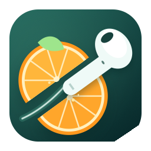
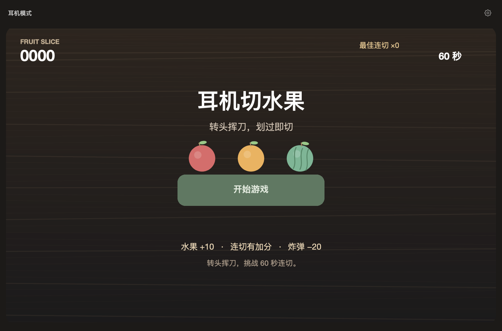
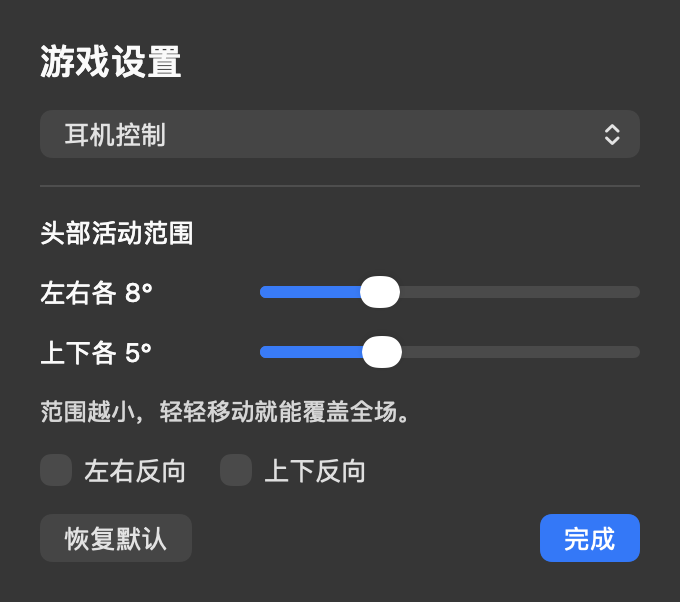

<p align="center">
  
</p>
<h1 align="center">耳机切水果</h1>
<p align="center">戴上 AirPods，轻轻转头挥动刀光，划过水果即可切开。</p>
<p align="center">macOS 14+ · Apple Silicon · v1.0.0</p>
<p align="center">
  <a href="#安装">安装</a> ·
  <a href="#开始游戏">开始游戏</a> ·
  <a href="#设置">设置</a> ·
  <a href="#开发">开发</a> ·
  <a href="https://github.com/lucifly/FruitSlice/issues">反馈</a>
</p>

## 预览



上图由当前应用的预览模式导出，展示实际界面，不代表佩戴耳机的实测记录。

## 安装

需要 **macOS 14 或更新版本**，以及能够向 Mac 提供运动数据的 AirPods。当前本地安装包面向 **Apple Silicon**；也可切换为鼠标控制体验游戏。

1. 获取本地构建生成的 `dist/FruitSlice-macOS-arm64.zip`，解压得到 `FruitSlice.app`。
2. 将应用移入“应用程序”文件夹，或直接打开。
3. 戴上并连接 AirPods，点击“开始游戏”，首次使用时允许运动数据权限。

当前包使用 **ad hoc 本地签名**，尚未进行 Developer ID 签名和 Apple 公证，未上架 App Store。GitHub 仓库提供源码，预编译安装包目前仅在本地生成；可按下方步骤自行构建。

## 开始游戏

1. 正视屏幕并保持稳定约 **2 秒**，校准后刀光回到中央，自动进入游戏。
2. 左右转头、抬头低头移动刀光，划过水果即可切开，无需点头确认。
3. 每局 **60 秒**。水果基础分 **+10**，连切额外加分；炸弹 **−20**，总分最低为 0 分。

游戏支持水果切面、果汁粒子和刀光轨迹。主界面保留游戏状态、开始／暂停和设置按钮；完成一局后，可将刀光停在“再来一局”约 1 秒重开。

## 设置

点击右上角齿轮，或按 **⌘ ,** 打开设置。设置会自动保存在本机；打开设置会暂停游戏，耳机模式下再次开始或继续时会重新校准。

| 设置 | 默认值 | 调整方式 |
| :--- | :--- | :--- |
| 控制方式 | 耳机控制 | 可切换为鼠标控制，移动鼠标即可切水果 |
| 左右活动范围 | 各 8° | 可调为各 3°–20°；范围越小，移动越灵敏 |
| 上下活动范围 | 各 5° | 可调为各 2°–12°；范围越小，移动越灵敏 |
| 左右／上下反向 | 关闭 | 可分别反转两个方向 |

<p align="center">
  
</p>

### 快捷键

| 快捷键 | 操作 |
| :--- | :--- |
| Enter / 空格 / ⌘ P | 开始、暂停或继续 |
| Esc | 暂停 |
| ⌘ R | 重新校准 |
| ⌘ , | 打开设置 |
| ⌘ Q | 退出游戏 |

### 使用提示

- 刀光偏离中心时，正视屏幕并按 **⌘ R** 重新校准。
- 需要转头过多时，调小对应方向的活动范围；移动过于敏感时则调大。
- 耳机数据中断、窗口切到后台或系统休眠时，游戏会暂停。回到游戏后点击“继续”并保持稳定，完成校准。
- 无法收到耳机数据时，检查连接和运动数据权限，也可以在设置中切换为鼠标控制。

## 隐私

控制只作用于游戏内，不移动系统光标。应用使用耳机运动数据，无需辅助功能、麦克风或摄像头权限；游戏不联网，正常游戏不会记录运动日志。

## 开发

<details>
<summary><strong>从源码构建</strong></summary>

需要 Xcode 或 Xcode Command Line Tools：

```sh
git clone https://github.com/lucifly/FruitSlice.git
cd FruitSlice
./build.command
open dist/FruitSlice.app
```

脚本按当前 Mac 架构编译，生成应用图标、执行现有逻辑检查、验证签名并打包。应用包仅包含程序、图标和必要的包元数据，不包含项目中的历史测试记录。

| 产物 | 路径 |
| :--- | :--- |
| 应用 | `dist/FruitSlice.app` |
| 压缩包 | `dist/FruitSlice-macOS-<当前架构>.zip` |

渲染使用 SpriteKit，运动输入通过 Core Motion 获取。内部可执行文件名保留为 `AirPodsMotionProbe`。

</details>

<details>
<summary><strong>检查与界面预览</strong></summary>

```sh
# 输入处理、校准、插值与游戏逻辑检查
./build/AirPodsMotionProbe.app/Contents/MacOS/AirPodsMotionProbe --self-test

# 导出主界面预览
./build/AirPodsMotionProbe.app/Contents/MacOS/AirPodsMotionProbe --preview-game /tmp/fruit-home.png

# 导出设置预览
./build/AirPodsMotionProbe.app/Contents/MacOS/AirPodsMotionProbe --preview-settings /tmp/fruit-settings.png

# 模拟运动输入并导出性能预览
./build/AirPodsMotionProbe.app/Contents/MacOS/AirPodsMotionProbe --benchmark-motion /tmp/fruit-benchmark.png
```

主界面没有诊断或性能监控入口。模拟检查覆盖输入处理与游戏逻辑；实际耳机的连接、延迟和操控手感需佩戴验证。

</details>
